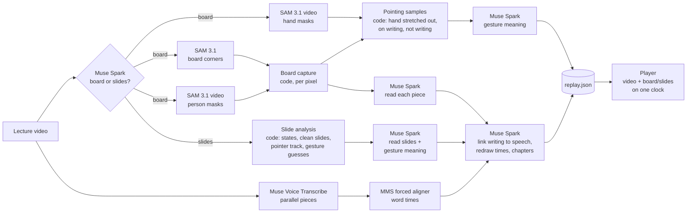

# Replay Board

**Rewatch a recorded lecture with a clean board beside it.** Upload a lecture video; Replay Board plays
the original, untouched, next to a virtual board that redraws the teacher's writing stroke by stroke,
in sync with their voice, including writing that was hidden behind the teacher while it was written.
Click any piece of writing to jump to the moment it was explained, or switch handwriting to typeset maths.
When the teacher points at the board (resting a finger on a line, tapping a result, sweeping under an
equation), the virtual board shows it as a calm spotlight, circle, underline or arrow on that writing.
Slide lectures get the same treatment: clean slides, and the teacher's cursor or laser turned into the
same animations.

Built for the Meta Global AI Developer Hackathon. **Meta models do the understanding**; plain code does
the per-pixel measurement.

## How it works



| Step | Done by | What it decides |
|---|---|---|
| Board or slides? | **Muse Spark 1.3** on 4 frames | type, board colour, webcam corner, subject |
| Where the board is | **SAM 3.1** ("whiteboard", then "blackboard", ...) on 3 frames | mask → convex hull → 4 corners |
| Who is in front of the board | **SAM 3.1 video mode** ("person") on a 2 fps copy | occlusion mask for every sample |
| What is written, where and when | board capture (code) | pieces of writing, erases, hidden writing |
| What each piece says | **Muse Spark** on sharp crops from the video | kind, text, LaTeX |
| Where the teacher's hand is | **SAM 3.1 video mode** ("hand") on a 3 fps copy | hand masks; code keeps moments where the hand is stretched out onto visible writing and no new ink follows |
| Slide changes, clean slides, pointer | slide analysis (code) | states, live regions, cursor/laser track, gesture guesses |
| What a pointing gesture means | **Muse Spark** with the path drawn on the slide (or on the video frame and the clean board) + the words spoken | spotlight / circle / underline / arrow / pulse, target elements, or "not pointing" |
| Words | **Muse Voice Transcribe** in parallel pieces | turns |
| Word times | **MMS forced aligner** (Meta, torchaudio) | per-word start/end |
| When each element is talked about | **Muse Spark** with elements + timed transcript | spoken ranges, redraw time of hidden writing, chapters |

Every model call goes through one client (`app/core/meta_api.py`) with retries, byte uploads and a disk
cache keyed by model + request, so re-running a lecture costs nothing. Measured calls and prices are in
[docs/meta-api-notes.md](docs/meta-api-notes.md).

### Board capture: "writing stays put, the teacher moves"
Frames are flattened onto the board at 3 fps. Ink is what morphological closing removes; each pixel keeps
counters that only move while the board is visible there (SAM person mask, plus built-in detectors for
large dark things and too-thick strokes). A pixel is accepted after 1 s of ink and removed after 2 s of
clean board. New pixels are grouped into pieces of writing; removals into erases. Writing that appears
long after its spot was last seen blank was written while hidden, and is redrawn when it was talked about.
Camera drift of a pixel or two is tolerated rather than treated as erase-and-rewrite. The result is a
per-pixel replay log; the player gets per-piece images with drawing-order and erase-time maps.

### Pointing on the board
SAM 3.1 tracks the teacher's hands at 3 fps. Code keeps a moment as pointing only when the hand is stretched
away from the body (not gesturing in front of the chest), its tip is on writing that is on the board at that
moment, and no new ink appears next to it in the following seconds (that would be writing). Nearby moments
become one gesture with a guessed shape (rest, sweep, circle). Muse Spark then sees the video frame and the
clean board with the hand's path drawn on both, plus the words spoken, and decides whether the teacher was
really pointing, at what, and how to show it. Most candidates are talking gestures and are dropped. When the
target is a block of several lines (often everything already on the board when the recording starts), Spark
gets that block zoomed in and says which line or term was meant; code fits the box to the ink. The
annotations are drawn on the virtual board only; the original video is never marked up.

### Self-tests on generated lectures
`tests/gen_board.py` and `tests/gen_slides.py` render lectures with known answers (a teacher who walks in
front of what he writes, an eraser, chalk, fade-ins, camera drift, a webcam corner, a parked cursor, a
laser...). The analysis is scored against them:

```text
python -m tests.selftest_board    ->  72/72 checks (6 variants)
python -m tests.selftest_slides   ->  47/47 checks (4 variants)
```

### What it costs and how long it takes
Measured on an 8-minute 1080p board lecture, nothing cached, on a 4-core laptop:

| | |
|---|---|
| Meta model calls | 100 (Muse Spark 86, SAM 3.1 11, Voice Transcribe 3) |
| API cost | $1.17: base $0.39 (SAM person masks $0.19) + pointing gestures $0.78 (SAM hands $0.29, Muse Spark judging 74 candidates $0.49) |
| First replay ready | 5.0 min |
| Word times refined (MMS) | 5.8 min (the replay is rewritten in place; the player picks it up) |
| Board capture alone | 3–12× real time, depending on what else the machine is doing |

That is about $9 per hour of lecture; with `--no-gestures` (no pointing on the board) about $3 per hour.
Re-running a lecture is free: every model answer is cached.

## Run it (Windows, PowerShell)

Needs Python 3.10–3.13, ffmpeg on PATH, Node 20+, and a Meta Model API key.

```powershell
py -3.13 -m venv .venv
.venv\Scripts\python -m pip install -r requirements.txt
copy .env.example .env        # then put your MODEL_API_KEY in .env
cd web; npm install; npm run build; cd ..
```

```powershell
.venv\Scripts\python -m app.server
```
Open http://127.0.0.1:8000, drop a lecture video, and watch the stages; the player opens when it's ready.

Or from the command line (writes `data\jobs\<name>-<hash>\replay.json`):
```powershell
.venv\Scripts\python -m app.process my-lecture.mp4 [--start 60] [--end 600] [--deck slides.pdf] [--no-gestures]
```
For a slide lecture you can add the PDF deck: Muse Spark then reads the crisp pages, and a page replaces the
video's slide wherever they match exactly (build steps and pen ink keep the video's image).

Tests:
```powershell
.venv\Scripts\python -m pytest -q             # unit tests
.venv\Scripts\python -m pytest -q -m selftest # generated-lecture self-tests (slow)
cd web; npm test
```

## Layout
```
app/            pipeline, CLI (app.process), server (app.server), smoke test (app.smoke)
app/core/       meta_api (one client), board, slides, sam, sam_codec, speech, understand, media
web/            player: React + Vite + TypeScript + KaTeX
tests/          generated-lecture self-tests and unit tests
data/           videos, job folders and the model cache (never committed)
```

## Also in the box
- **Study notes**: the player's Notes page lists every line of writing (or slide element) by chapter, typeset with
  KaTeX, with what was said; each time links back to that moment in the player. Download as Markdown or print.
- **Typeset by line**: a line written in bursts (several pieces) is read by Muse Spark as one line and typeset whole
  once it is finished; until then its pieces draw one by one, in time.
- **3D pop-out** (stretch): for a drawn graph, surface or solid, Muse Spark returns a small JSON scene that the
  player renders with three.js. The scene is pure data: maths expressions are checked against a whitelist on
  the server and evaluated by the player's own parser, never as code.

## Limits
- The camera must stay still (a tripod or a fixed classroom camera). Panning or zooming cameras are not handled.
- MMS word alignment runs on the CPU at 1–3× real time; for long lectures the replay appears first with
  turn-level word times and is refined in place.
- Handwriting reading is as good as the frame: very small or blurry writing may be read partly.

## Privacy and video rules
The original video is never altered: no outlining, blurring or removing the teacher. Videos and anything
made from them stay in `data/`, which is not committed.
