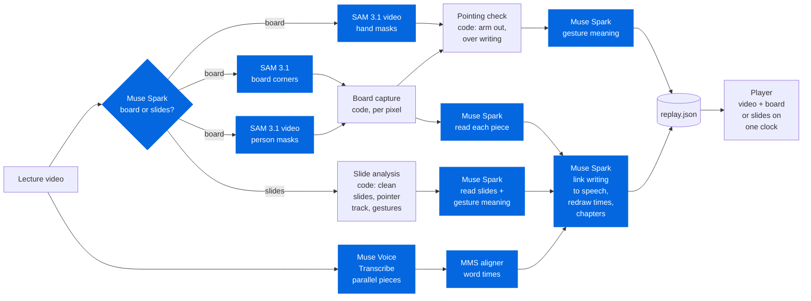

<p align="center">
  <picture>
    <source media="(prefers-color-scheme: dark)" srcset="docs/images/wordmark-dark.svg">
    
  </picture>
</p>

<p align="center">
  Upload a recorded lecture. Watch the original, untouched, beside a clean board<br>
  that redraws the writing stroke by stroke, in sync with the voice.
</p>

<p align="center">
  <picture>
    <source media="(prefers-color-scheme: dark)" srcset="docs/images/hackathon-dark.svg">
    
  </picture>
  <a href="#meta-models-and-what-each-one-does"><picture>
    <source media="(prefers-color-scheme: dark)" srcset="docs/images/models-dark.svg">
    
  </picture></a>
  <br>
  <a href="#run-it"><picture>
    <source media="(prefers-color-scheme: dark)" srcset="docs/images/stack-dark.svg">
    
  </picture></a>
</p>

## Why

Rewatching a recorded lecture is hard:
- the teacher stands in front of what they're writing;
- the camera can't read the board well;
- on slides, the cursor never stops moving.

Replay Board takes the recording as it is. **Meta models do the understanding**; plain code does the
per-pixel measurement.

## What you get

| | Feature | In one line |
|---|---|---|
| ✍️ | **Clean board** | The writing is redrawn stroke by stroke on the video's clock, even writing hidden behind the teacher. |
| 🎯 | **Click to jump** | Click any line to hear it explained. Press **T** to switch handwriting to typeset maths; a line written in bursts is typeset whole once it's finished. |
| 👉 | **Pointing** | When the teacher points at the board, it shows a calm spotlight, circle, underline or arrow on that writing. |
| 🖥️ | **Slide lectures** | Clean slides, the webcam blanked, and the restless cursor or laser turned into the same calm marks. |
| 💬 | **Ask Muse** | Ask about the whole lecture. Answers cite times and board items you can click. Press **A**. |
| 🧊 | **3D steps** | A drawing becomes a 3D model that changes at the very words that explain it. Then **Try it** with sliders. |
| 📊 | **Slides export** | The **Slides** button: Muse Spark writes a deck that teaches the lecture, downloaded as a real PowerPoint. |
| 📝 | **Study notes** | The **Notes** page: every line of writing by chapter, typeset, with what was said; each time links back to the video. Markdown or print. |
| 🕒 | **Timed transcript** | Every word timed, chapters taken from the lecture itself. |

**The original video is never altered**: no outlining, blurring or removing the teacher.

<details>
<summary><b>Ask Muse</b>: what you can attach, and what it costs</summary>

- Open it with the button or the **A** key.
- Attach anything from any point of the lecture:
  - writing from the board (its tooltip's "Ask", or Shift+click);
  - slide text, or a stretch of the transcript (select it);
  - "this moment";
  - an item from a searchable list of everything in the lecture, including writing later erased.
- Muse Spark gets the whole lecture every time, so a question can link the first minute to the last.
- The answer streams in. `[5:44]` times seek the video; item chips show the writing typeset, jump to where the
  board shows it, and outline it there.
- The conversation is kept per lecture.
- Cost on an 8-minute lecture: about $0.01 for a first question, $0.006 for a follow-up (Meta's prompt cache
  reuses the lecture), nothing for a repeated one (disk cache).

</details>

<details>
<summary><b>3D steps</b>: how a drawing comes alive</summary>

- Hover or tap a drawing and click **3D** in its tooltip. Once made, it gets a small "3D" badge on the board,
  and a **Watch in 3D** pill while the teacher explains it.
- Click it: the 3D view takes the board's place while the video keeps playing, and the model changes at each
  cue word. In a crystal lecture, one cell turns from cubic into tetragonal, orthorhombic, rhombohedral and
  monoclinic, with its angles measured live ("β 75°").
- Muse Spark writes the scene as **pure data**: shapes, graphs, surfaces, curves, angles, parameters, and steps
  that show, hide, highlight, move the camera or ease a parameter.
- The server checks it before you see it:
  - every maths expression against a small grammar (the player compiles the same grammar, never runs code);
  - every state of every step is evaluated;
  - each step moves onto the time of its cue word from the aligner;
  - steps that change nothing are dropped; slider ranges are narrowed to shapes that can exist.
- **Try it** gives a slider per value. Step chips and the `[` `]` keys jump the video to a step.
- One scene per drawing, made on the first open (30–70 s, about $0.03–0.10), then cached.
  `.venv\Scripts\python -m app.popout <job> <piece>` makes them ahead of time (it shows the cost and asks
  first).

</details>

<details>
<summary><b>Slides export</b>: what goes into the deck</summary>

- Muse Spark plans the deck from the whole lecture (sections, slides, which writing goes where), then writes the
  parts in parallel.
- Slides have titles that say what they teach, bullets, typeset formulas, numbered worked steps, comparison
  tables, definition and key-idea boxes, and figures made from the teacher's own drawings (the ink lifted off the
  board, not a photo).
- Code checks every answer:
  - each piece of writing that matters lands on a slide;
  - the LaTeX is valid;
  - a formula of plain numbers is worked out (a rounded result gets ≈, a false one is left out);
  - text fits the layout.
- The **PowerPoint** (16:9) has real titles, native bullets and tables, an agenda, key takeaways, a formula
  sheet, and speaker notes with what was said and when. Equations keep their LaTeX as alt text.
- The page also previews the slides, with **Present** (full screen) and **Save as PDF**.
- Cost on an 8-minute lecture: about $0.08 and 25–30 s, once; then it's cached.

</details>

<details>
<summary><b>Keys</b> in the player</summary>

| Key | Does |
|---|---|
| Space | Play or pause |
| ← → | Back or forward 5 s |
| T | Handwriting ↔ typeset (board lectures) |
| P | Show or hide the pointer (slide lectures) |
| A | Open or close Ask Muse |
| `[` `]` | Previous or next step in the 3D view |
| Esc | Close what's open |
| ? | All keys |

</details>

## Meta models, and what each one does

| Model | Used for | Calls to process an 8-min lecture |
|---|---|---|
| **Muse Spark 1.3** | Board or slides? · reading every piece of writing · linking writing to speech · chapters · what a pointing gesture means · Ask Muse · 3D steps · slides export | 86 |
| **SAM 3.1** | Finding the board · tracking the teacher and their hands (video mode) | 11 |
| **Muse Voice Transcribe** | The words, in parallel pieces | 3 |
| **MMS forced aligner** (torchaudio) | The time of every word | runs locally |

- Every call goes through **one client** (`app/core/meta_api.py`): retries, byte uploads, a cost log and a disk
  cache keyed by model and request.
- So **re-running a lecture is free**.
- Ask Muse, 3D steps and slides export call Muse Spark on demand, on top of these.
- Measured calls and prices: [docs/meta-api-notes.md](docs/meta-api-notes.md).

## Run it

**You need:** Windows with PowerShell · Python 3.10–3.13 · ffmpeg on PATH · Node 22.18+ (the player's tests run
TypeScript directly) · a Meta Model API key.

**1. Install**
```powershell
py -3.13 -m venv .venv
.venv\Scripts\python -m pip install -r requirements.txt
copy .env.example .env        # then put your MODEL_API_KEY in .env
cd web; npm install; npm run build; cd ..
```

**2. Start**
```powershell
.venv\Scripts\python -m app.server
```

**3. Use it:** open `http://127.0.0.1:8000`, drop a lecture video, click **Upload and process**, and watch the
stages tick. The player opens when it's ready.

<details>
<summary>From the command line instead</summary>

```powershell
.venv\Scripts\python -m app.process my-lecture.mp4 [--start 60] [--end 600] [--deck slides.pdf] [--no-gestures]
```
- Writes `data\jobs\<name>-<hash>\replay.json`.
- `--deck`: for a slide lecture, the PDF of the slides. Muse Spark reads the crisp pages, and a page replaces
  the video's slide wherever they match exactly (build steps and pen ink keep the video's image).
- `--no-gestures`: skips pointing on the board, about half the API cost.
- `--no-cache`: asks the models again instead of using saved answers. Also `--job`, `--no-sam`, `--width`
  (see `--help`).

</details>

<details>
<summary>Settings in <code>.env</code></summary>

| Setting | Default | What it is |
|---|---|---|
| `MODEL_API_KEY` | (required) | Your Meta Model API key. Never committed. |
| `MODEL_SPARK`, `MODEL_TRANSCRIBE`, `MODEL_SAM` | `muse-spark-1.3`, `muse-voice-transcribe-1.0`, `sam-3.1` | Model ids |
| `META_API_CACHE` | `data/cache/meta` | Where model answers are saved |
| `META_API_MAX_PARALLEL` | `8` | Model calls at once |
| `VIDEO_DECODE` | `auto` | `auto` decodes on the GPU (Windows) where it gives the same frames; `cpu` never does |

</details>

## How it works



Blue boxes are Meta models.

<details>
<summary>Every step, and who does it</summary>

| Step | Done by | What it decides |
|---|---|---|
| Board or slides? | **Muse Spark 1.3** on 4 frames | type, board colour, webcam corner, subject |
| Where the board is | **SAM 3.1** ("whiteboard", then "blackboard", ...) on 3 frames | mask → convex hull → 4 corners |
| Who is in front of the board | **SAM 3.1 video mode** ("person") on a 2 fps copy | occlusion mask for every sample |
| What is written, where and when | board capture (code) | pieces of writing, erases, hidden writing |
| What each piece says | **Muse Spark** on sharp crops from the video | kind, text, LaTeX |
| Where the teacher's hand is | **SAM 3.1 video mode** ("hand") on a 3 fps copy | hand masks; code keeps moments where the hand is stretched out onto visible writing and no new ink follows |
| Slide changes, clean slides, pointer | slide analysis (code) | states, live regions, cursor/laser track, gesture guesses |
| What a pointing gesture means | **Muse Spark** with the path drawn on the slide (or on the video frame and the clean board) + the words spoken | spotlight / circle / underline / arrow / pulse, target elements, or "not pointing" |
| Questions about the lecture | **Muse Spark** with the whole lecture as a cached prefix, plus images of what the student attached | a streamed answer that cites clickable times and board items |
| 3D steps | **Muse Spark** with the drawing, the writing around it and the timed transcript | a 3D scene as data and up to 12 steps that change it, each at the teacher's cue word |
| Slides export | **Muse Spark** with the whole lecture: one call plans the deck, then one call per part (4 at a time) | sections, which writing goes where, then each slide |
| Words | **Muse Voice Transcribe** in parallel pieces | turns |
| Word times | **MMS forced aligner** (Meta, torchaudio) | per-word start and end |
| When each element is talked about | **Muse Spark** with elements + timed transcript | spoken ranges, redraw time of hidden writing, chapters |

</details>

<details>
<summary>Board capture: "writing stays put, the teacher moves"</summary>

- Frames are flattened onto the board at 3 fps.
- Ink is what morphological closing removes.
- Each pixel keeps counters that only move while the board is visible there: the SAM person mask, plus
  built-in detectors for large dark things and too-thick strokes.
- A thick shape that stays put for 1 s, clear of the teacher, is writing (a filled arrowhead, a heavy underline,
  two strokes crossing).
- A pixel is accepted after 1 s of ink and removed after 2 s of clean board.
- New pixels are grouped into pieces of writing; removals into erases.
- Writing that comes into view all at once, long after its spot was last seen blank, was written while hidden.
  It is redrawn when it was talked about, never before its spot could hold it.
- A camera drift of a pixel or two is tolerated, not treated as erase-and-rewrite.
- The player gets per-piece images with drawing-order and erase-time maps.

</details>

<details>
<summary>Pointing on the board</summary>

- SAM 3.1 tracks the teacher's hands at 3 fps.
- Code keeps a moment as pointing only when:
  - the hand is stretched away from the body (not gesturing in front of the chest);
  - its tip is on writing that is on the board at that moment;
  - no new ink appears next to it in the following seconds (that would be writing).
- Nearby moments become one gesture with a guessed shape (rest, sweep, circle).
- Muse Spark then sees the video frame and the clean board with the hand's path drawn on both, plus the words
  spoken, and decides whether it really was pointing, at what, and how to show it. Most candidates are talking
  gestures and are dropped.
- For a block of several lines, Spark gets the block zoomed in and says which line or term was meant; code fits
  the box to the ink.
- The marks are drawn on the virtual board only.

</details>

## Cost and speed

Measured on an 8-minute 1080p board lecture, nothing cached, on a 4-core laptop:

| Measured | Result |
|---|---|
| Meta model calls | 100 (Muse Spark 86, SAM 3.1 11, Voice Transcribe 3) |
| API cost | **$1.17**: base $0.39 (SAM person masks $0.19) + pointing gestures $0.78 (SAM hands $0.29, Muse Spark judging 74 candidates $0.49) |
| First replay ready | 5.0 min |
| Word times refined (MMS) | 5.8 min (the replay is updated in place) |
| Board capture, 1080p | 8–9× real time with GPU decoding (6–7.5× in software) |
| …while the video is also prepared for SAM 3.1 | 4–4.5× real time (1.5–2× in software) |

- **Per hour of lecture:** about $9, or about $3 with `--no-gestures`.
- Board capture was measured on 2 minutes of the same lecture. The other times were measured before GPU
  decoding was added.
- **An hour-long lecture**, measured for $0 with saved model answers (gestures off):
  - capture: 9.0–9.8 min (6.1–6.6× real time, in software);
  - first replay: about 16–18 min, final word times about 30 min (with the models' logged delays added);
  - pointing gestures add about 4–7 min;
  - peak memory 7.6 GB, most of it the MMS aligner.
- **The player** shows an hour-long replay (10,060 words, 252 pieces) in under 2 s and seeks in under 0.5 s.

## Tested

Generated lectures with known answers keep the analysis honest:
- `tests/gen_board.py`: a teacher walking in front of his writing, an eraser, chalk, fade-ins, camera drift,
  filled arrowheads, crossing strokes.
- `tests/gen_slides.py`: build steps, a webcam corner, a parked cursor, a laser.
- `tests/gen_scene_lectures.py`: narrated 3D lectures (a vector, a cylinder's volume, a saddle surface), with what
  must hold at each spoken stage.

```powershell
.venv\Scripts\python -m tests.selftest_board    # 136/136 checks (8 variants)
.venv\Scripts\python -m tests.selftest_slides   # 47/47 checks (4 variants)
.venv\Scripts\python -m pytest -q               # unit tests
.venv\Scripts\python -m pytest -q -m selftest   # generated-lecture self-tests (slow)
cd web; npm test                                # player tests
```

<details>
<summary>Project layout</summary>

```
app/            pipeline, CLI (app.process), server (app.server), Ask Muse (ask), study notes (notes), slides
                export (export, pptx_deck), 3D steps (popout), settings (config), smoke test
app/core/       meta_api (one client), board, board_gestures (pointing), lines, slides, deck (PDF decks), sam,
                sam_codec, speech, understand, media, texrender, scene_expr (the 3D maths grammar)
web/            player: React + Vite + TypeScript + KaTeX
docs/           Meta API notes, demo script, submission text, README images
tests/          generated-lecture self-tests and unit tests
data/           videos, job folders and the model cache (never committed)
```

</details>

## Limits

- The camera must stay still (a tripod or a fixed classroom camera). Panning or zooming is not handled.
- The MMS aligner runs on the CPU, at about 2–4× real time. On a long lecture the replay comes first and its word
  times are refined in place.
- Peak memory is 7.6 GB on an hour-long lecture: use a machine with 16 GB.
- Reading handwriting is only as good as the frame: very small or blurry writing may be read partly.

## What's next

- A browser extension for lecture platforms that allow it, on the same backend.
- Moving cameras (pan and zoom).
- The MMS aligner on a GPU, so an hour of lecture gets its word times in minutes.

## Privacy

Videos and anything made from them stay in `data/`, which is never committed.

## License

MIT, see [LICENSE](LICENSE).
